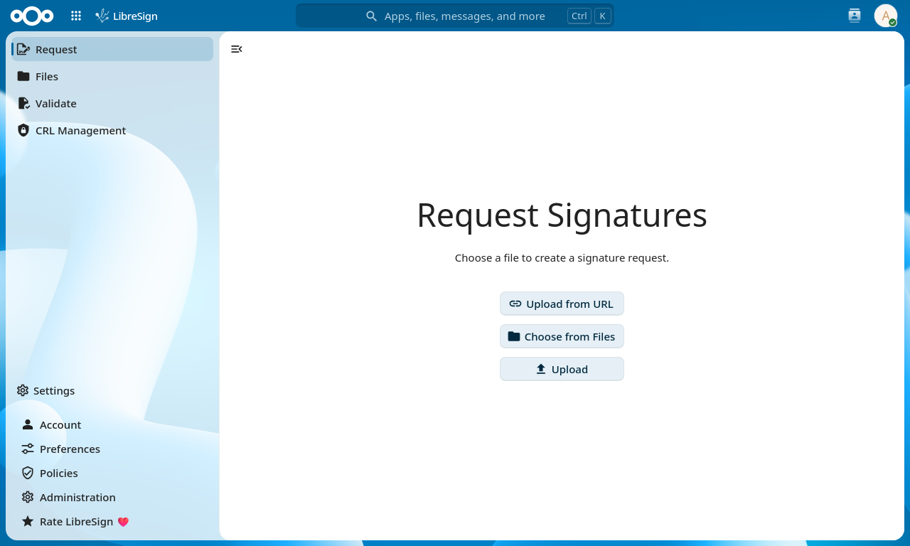

<!--
 - SPDX-FileCopyrightText: 2020-2026 LibreCode coop and contributors
 - SPDX-License-Identifier: AGPL-3.0-or-later
-->

[-3333AB?logo=)](https://digitalpublicgoods.net/r/libresign)

# LibreSign

**Free and open-source electronic signatures for Nextcloud.**

LibreSign is a Nextcloud app for requesting, signing, tracking, and validating documents, including PDFs. It runs **inside a Nextcloud server**, including self-hosted deployments; **it is not an independent standalone signing server**. It works with Nextcloud files and permissions, so you can manage signing workflows on infrastructure you control.

An existing application can keep its own portal, authentication, and business process while its backend uses LibreSign's OCS/REST API to request and track signatures. **The API is included in the free and open-source LibreSign software**, with no separate API license or subscription required. Protected operations use the host Nextcloud installation's authentication and permissions, plus LibreSign's configured policies.

The integration typically authenticates as an authorized Nextcloud account using a revocable App Password. **External signers can sign without creating a Nextcloud account** when an external identification and signing method is enabled and configured (for example, email). The integration account is not the signer's identity, and its credentials must not be passed to signers.

## Key features

- Define signing order, roles, and rules per document flow
- Include internal and external signers in the same request
- Request and track signatures from start to completion
- Send notifications and reminders to signers
- Keep a traceable record of requests, actions, and validations
- Validate signed documents and certificate status
- Work directly with Nextcloud files, users, and sharing context
- Integrate signing with other systems through APIs

## Why LibreSign

LibreSign is for teams where signing is part of a controlled business process.

- Define clear signing rules by role, stage, or document type
- Keep traceability for audits, legal checks, and internal reviews
- Align signing with existing approval and governance processes
- Adapt workflows to how your organization works instead of following fixed external models

## Contributing

Contributions are welcome from developers, implementers, and teams that use LibreSign in production.

- See the current product direction: [LibreSign Roadmap](https://github.com/orgs/LibreSign/projects/2)
- Report bugs or suggest improvements: [Open an issue](https://github.com/LibreSign/libresign/issues)
- Start with simple tasks: [Good first issues](https://github.com/search?q=org%3ALibreSign%20is%3Aissue%20is%3Aopen%20label%3A%22good%20first%20issue%22&type=issues)
- Help with translations: [Transifex](https://app.transifex.com/nextcloud/nextcloud/libresign)

## Contributors

Thanks to all the people who contribute to LibreSign:

## Screenshots

  

## Documentation

- [Official documentation and version selector](https://docs.libresign.coop/)
- [Nextcloud App Store](https://apps.nextcloud.com/apps/libresign)
- [Developer manual (development branch, unreleased)](https://docs.libresign.coop/main/developer_manual/)
- [Documentation source and contribution guidelines](https://github.com/LibreSign/documentation)

### Integration guides by version

Select the guide matching your installed LibreSign release; `/api/v1` is the OCS protocol version, **not** the application major version. Authentication, request payloads, and available features depend on the release and administrator configuration.

| LibreSign / Nextcloud | Integration guide | External signer guide | OpenAPI contract | Bash/PHP examples |
| --- | --- | --- | --- | --- |
| 13 / 33 | [Architecture](https://docs.libresign.coop/13/developer_manual/integration/index.html) | [External email signers](https://docs.libresign.coop/13/developer_manual/api/external-email-signers.html) | [OpenAPI](https://docs.libresign.coop/13/developer_manual/api/openapi.html) | [Examples](https://github.com/LibreSign/documentation/tree/stable13/examples/external-email-signers) |
| 14 / 34 | [Architecture](https://docs.libresign.coop/14/developer_manual/integration/index.html) | [External email signers](https://docs.libresign.coop/14/developer_manual/api/external-email-signers.html) | [OpenAPI](https://docs.libresign.coop/14/developer_manual/api/openapi.html) | [Examples](https://github.com/LibreSign/documentation/tree/stable14/examples/external-email-signers) |
| 15 / 35 | [Architecture](https://docs.libresign.coop/15/developer_manual/integration/index.html) | [External email signers](https://docs.libresign.coop/15/developer_manual/api/external-email-signers.html) | [OpenAPI](https://docs.libresign.coop/15/developer_manual/api/openapi.html) | [Examples](https://github.com/LibreSign/documentation/tree/stable15/examples/external-email-signers) |
| Development (unreleased) | [Architecture](https://docs.libresign.coop/main/developer_manual/integration/index.html) | [External email signers](https://docs.libresign.coop/main/developer_manual/api/external-email-signers.html) | [OpenAPI](https://docs.libresign.coop/main/developer_manual/api/openapi.html) | [Examples](https://github.com/LibreSign/documentation/tree/main/examples/external-email-signers) |

- [Importable n8n signing workflow](https://github.com/LibreSign/documentation/blob/main/examples/n8n/README.md) — example with one email signer, release-specific request selection, and prerequisites for Nextcloud storage and WebDAV.

## Sponsors

If your organization depends on LibreSign, please sponsor the project.

Sponsorship directly supports ongoing maintenance, reliable releases, better documentation, and long-term continuity for teams that rely on LibreSign in real workflows.

Support LibreSign: https://github.com/sponsors/LibreSign
